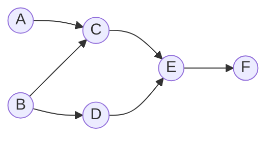
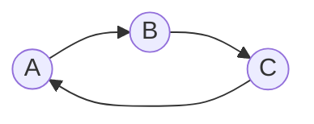
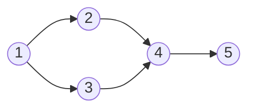


  recommended:
    - name: Course Schedule
      url: https://cses.fi/problemset/task/1679/
      platform: CSES
      difficulty: easy
      topics: [Kahn, DAG]
      objective: Implementar diretamente o algoritmo de Kahn.
    - name: Longest Path
      url: "https://atcoder.jp/contests/dp/tasks/dp_g?lang=en"
      platform: AtCoder
      difficulty: medium
      topics: [DAG, programação dinâmica]
      objective: Combinar ordenação topológica com programação dinâmica.
    - name: Longest Flight Route
      url: https://cses.fi/problemset/task/1680/
      platform: CSES
      difficulty: hard
      topics: [DAG, programação dinâmica, reconstrução de caminho]
      objective: Usar DP e reconstruir o caminho em um DAG.


# Ordenação Topológica

**Dificuldade:** Intermediário  
**Pré-requisitos:** Grafos direcionados, listas de adjacência, filas e graus dos vértices  
**Algoritmos:** Kahn e DFS

## Introdução

Imagine que precisamos organizar um conjunto de disciplinas de uma universidade. Algumas disciplinas possuem pré-requisitos, portanto não podemos cursá-las em qualquer ordem.

Por exemplo:

- Para cursar `C`, precisamos concluir `A`.
- Para cursar `D`, precisamos concluir `B` e `C`.
- Para cursar `E`, precisamos concluir `D`.

Nosso objetivo é encontrar uma ordem que respeite todas essas dependências.

Esse é um problema de **ordenação topológica**.

!!! info "Definição"
    Uma ordenação topológica de um grafo direcionado é uma sequência de seus vértices na qual, para toda aresta `u → v`, o vértice `u` aparece antes do vértice `v`.

    Uma ordenação topológica existe se, e somente se, o grafo é um **DAG** (*Directed Acyclic Graph*), isto é, um grafo direcionado sem ciclos.

### Exemplo

Considere o grafo com as seguintes dependências:

```text
A → C
B → C
B → D
C → E
D → E
E → F
```

<!-- AUXÍLIO VISUAL 1
Tipo: Diagrama de grafo direcionado.
Objetivo: Mostrar as dependências entre os vértices.
Sugestão: Utilizar Mermaid ou uma imagem SVG.
-->



Uma ordenação topológica válida seria:

```text
A, B, C, D, E, F
```

Outra possibilidade:

```text
B, A, D, C, E, F
```

Ambas são válidas, pois todas as dependências foram respeitadas.

Observe que **a ordenação topológica não precisa ser única**.

## Algoritmo de Kahn

O algoritmo de Kahn encontra uma ordenação topológica utilizando os **graus de entrada** dos vértices.

O grau de entrada de um vértice `v`, representado por `indegree[v]`, corresponde ao número de arestas que chegam até ele.

A ideia principal é simples:

> Um vértice pode ser processado quando todas as suas dependências já foram processadas.

No algoritmo, isso equivale a ter grau de entrada igual a zero no grafo restante.

### Passos do algoritmo

1. Calcular o grau de entrada de todos os vértices.
2. Inserir em uma fila todos os vértices com grau de entrada zero.
3. Enquanto a fila não estiver vazia:
    - Remover um vértice `u` da fila.
    - Adicionar `u` à ordenação.
    - Para cada aresta `u → v`, diminuir `indegree[v]`.
    - Se `indegree[v]` se tornar zero, inserir `v` na fila.
4. Verificar quantos vértices foram processados.

Se todos os vértices foram processados, encontramos uma ordenação topológica válida.

Caso contrário, o grafo contém pelo menos um ciclo direcionado.

!!! tip "Intuição"
    Processar um vértice equivale a removê-lo, juntamente com suas arestas de saída, do grafo restante.

    Quando o grau de entrada de outro vértice chega a zero, significa que todas as suas dependências foram removidas.

## Exemplo passo a passo

Considere o grafo:


### 1. Calculando os graus de entrada

| Vértice | Grau de entrada |
|---|---:|
| A | 0 |
| B | 0 |
| C | 2 |
| D | 1 |
| E | 2 |
| F | 1 |

Os vértices `A` e `B` não possuem dependências.

Portanto, inicialmente:

```text
Fila: [A, B]
Ordenação: []
```

### 2. Processando os vértices

Vamos utilizar uma fila FIFO e considerar os vizinhos na ordem apresentada no grafo.

| Iteração | Vértice removido | Atualização | Fila após a operação | Ordenação |
|---|---|---|---|---|
| 1 | A | C: 2 → 1 | [B] | [A] |
| 2 | B | C: 1 → 0, D: 1 → 0 | [C, D] | [A, B] |
| 3 | C | E: 2 → 1 | [D] | [A, B, C] |
| 4 | D | E: 1 → 0 | [E] | [A, B, C, D] |
| 5 | E | F: 1 → 0 | [F] | [A, B, C, D, E] |
| 6 | F | Nenhuma | [] | [A, B, C, D, E, F] |

Como todos os seis vértices foram processados, a ordenação é válida.

Resultado:

```text
A → B → C → D → E → F
```

!!! warning "A ordenação não representa necessariamente um caminho"
    A sequência acima não significa que existem arestas entre todos os vértices consecutivos.

    Uma ordenação topológica apenas determina uma ordem que respeita todas as dependências.

<!--### Sugestão de visualização passo a passo

AUXÍLIO VISUAL 2 — RECOMENDADO

Adicionar uma animação GIF ou uma sequência de imagens
mostrando as seis iterações do algoritmo de Kahn.

Cada quadro deve mostrar:
- O grafo original.
- Os vértices já processados em cinza.
- O vértice atual destacado.
- Os graus de entrada atualizados.
- O conteúdo da fila.
- A ordenação construída até aquele momento.

Arquivo sugerido:
assets/images/grafos/ordenacao-topologica/kahn-passos.gif

Para adicionar futuramente, remover o comentário abaixo.
-->

<!--

-->

## Implementação em C++17

Vamos implementar o algoritmo para encontrar uma ordenação topológica de um grafo com `N` vértices e `M` arestas.

Os vértices são numerados de `1` até `N`.

### Código completo

```cpp
#include <bits/stdc++.h>
using namespace std;

vector<int> topological_sort(int n, const vector<vector<int>>& adj) {
    vector<int> indegree(n + 1, 0);

    // Calcula os graus de entrada
    for (int u = 1; u <= n; u++) {
        for (int v : adj[u]) {
            indegree[v]++;
        }
    }

    queue<int> q;

    // Vértices sem dependências
    for (int u = 1; u <= n; u++) {
        if (indegree[u] == 0) {
            q.push(u);
        }
    }

    vector<int> order;

    while (!q.empty()) {
        int u = q.front();
        q.pop();

        order.push_back(u);

        for (int v : adj[u]) {
            indegree[v]--;

            if (indegree[v] == 0) {
                q.push(v);
            }
        }
    }

    // Detecta a existência de ciclos
    if ((int)order.size() != n) {
        return {};
    }

    return order;
}

int main() {
    ios::sync_with_stdio(false);
    cin.tie(nullptr);

    int n, m;
    cin >> n >> m;

    vector<vector<int>> adj(n + 1);

    for (int i = 0; i < m; i++) {
        int u, v;
        cin >> u >> v;

        adj[u].push_back(v);
    }

    vector<int> order = topological_sort(n, adj);

    if (order.empty()) {
        cout << "IMPOSSIBLE\n";
        return 0;
    }

    for (int u : order) {
        cout << u << " ";
    }

    cout << "\n";
}
```

### Exemplo de entrada

```text
6 6
1 3
2 3
2 4
3 5
4 5
5 6
```

### Saída possível

```text
1 2 3 4 5 6
```

Outras ordenações que respeitem todas as dependências também são válidas.

## Por que o algoritmo funciona?

A correção do algoritmo pode ser compreendida por duas propriedades.

### 1. Todo vértice processado está em uma posição válida

O algoritmo só adiciona um vértice `v` à ordenação quando seu grau de entrada no grafo restante é zero.

Isso significa que todas as arestas que originalmente chegavam até `v` foram removidas após o processamento de seus vértices de origem.

Logo, todos os predecessores de `v` já aparecem antes dele na ordenação.

Portanto, nenhuma dependência é violada.

### 2. Todo DAG possui pelo menos um vértice com grau de entrada zero

Suponha, por contradição, que um grafo direcionado finito e não vazio não tenha vértices com grau de entrada zero.

Partindo de qualquer vértice, podemos sempre seguir uma aresta no sentido contrário, para algum predecessor.

Como o grafo possui um número finito de vértices, eventualmente precisaremos visitar novamente algum vértice.

Isso formaria um ciclo direcionado.

Portanto, todo DAG não vazio possui pelo menos um vértice com grau de entrada zero.

Consequentemente, o algoritmo de Kahn sempre consegue processar um novo vértice enquanto o grafo restante for um DAG não vazio.

Assim, se o grafo não possui ciclos, todos os vértices serão processados.

## Detecção de ciclos

Uma aplicação interessante do algoritmo é detectar ciclos em grafos direcionados.

Considere:



Nesse grafo:

```text
indegree[A] = 1
indegree[B] = 1
indegree[C] = 1
```

Nenhum vértice possui grau de entrada zero.

Logo, a fila inicial está vazia e o algoritmo não consegue processar nenhum vértice.

Isso ocorre porque existe uma dependência circular:

```text
A → B → C → A
```

<!-- AUXÍLIO VISUAL 3

Imagem comparativa com dois grafos:
- À esquerda, um DAG com ordenação topológica.
- À direita, um grafo com ciclo destacado em vermelho.

Objetivo: Demonstrar por que ciclos impedem
a existência de uma ordenação topológica.

Arquivo sugerido:
assets/images/grafos/ordenacao-topologica/dag-vs-ciclo.svg
-->

<!--

-->

!!! note "Importante"
    Se a ordenação retornada possui menos de `N` vértices, sabemos que o grafo possui pelo menos um ciclo.

    Entretanto, os vértices que não foram processados não necessariamente pertencem a algum ciclo. Alguns podem apenas depender de vértices que estão em ciclos.

## Análise de complexidade

Sejam:

- `V`: número de vértices.
- `E`: número de arestas.

### Complexidade temporal

O algoritmo realiza as seguintes etapas:

| Etapa | Complexidade |
|---|---|
| Inicializar os graus de entrada | O(V) |
| Percorrer todas as arestas | O(E) |
| Inserir vértices iniciais na fila | O(V) |
| Processar os vértices | O(V) |
| Atualizar os graus de entrada | O(E) |

Cada vértice é inserido na fila no máximo uma vez.

Além disso, cada aresta é percorrida uma vez durante o cálculo dos graus de entrada e uma vez durante o processamento.

Portanto, a complexidade total é:

$$
\boxed{O(V+E)}
$$

### Complexidade espacial

A representação do grafo por listas de adjacência ocupa:

$$
O(V+E)
$$

Além disso, o algoritmo utiliza:

- Vetor de graus de entrada: $O(V)$.
- Fila: $O(V)$.
- Vetor de ordenação: $O(V)$.

Logo, incluindo o armazenamento do grafo, a complexidade espacial total é:

$$
\boxed{O(V+E)}
$$

O espaço auxiliar do algoritmo, desconsiderando o grafo já armazenado, é $O(V)$.

## Aplicação: Programação Dinâmica em DAGs

A ordenação topológica também é útil para resolver problemas de programação dinâmica em grafos direcionados acíclicos.

Considere o problema de encontrar o **maior comprimento de um caminho direcionado em um DAG**.

Definimos:

$$
dp[v] = \text{comprimento do maior caminho que termina em }v
$$

Inicialmente:

$$
dp[v] = 0
$$

Para cada aresta `u → v`, podemos atualizar:

$$
dp[v] = \max(dp[v], dp[u] + 1)
$$

Se processarmos os vértices em ordem topológica, todas as informações necessárias para calcular `dp[v]` já terão sido consideradas quando chegarmos ao vértice `v`.

### Exemplo

Considere:



Uma ordenação válida é:

```text
1, 2, 3, 4, 5
```

Os valores finais são:

| Vértice | dp[v] |
|---|---:|
| 1 | 0 |
| 2 | 1 |
| 3 | 1 |
| 4 | 2 |
| 5 | 3 |

O maior caminho possui três arestas.

### Código da transição

Após obter a ordenação topológica:

```cpp
vector<int> dp(n + 1, 0);

for (int u : order) {
    for (int v : adj[u]) {
        dp[v] = max(dp[v], dp[u] + 1);
    }
}

int answer = *max_element(
    dp.begin() + 1,
    dp.end()
);
```

Essa abordagem também possui complexidade $O(V+E)$.

<!-- AUXÍLIO VISUAL 4 — RECOMENDADO

Diagrama do DAG com cada vértice contendo
seu valor dp[v].

Destacar, em cada etapa, a propagação:

dp[v] = max(dp[v], dp[u] + 1)

Sugestão: GIF mostrando a atualização dos
valores de programação dinâmica.

Arquivo:
assets/images/grafos/ordenacao-topologica/dp-dag.gif
-->

<!--

-->

## Variações

### Ordenação topológica com DFS

Também é possível encontrar uma ordenação topológica utilizando DFS.

A ideia é adicionar cada vértice à resposta depois de visitar todos os seus vizinhos e inverter a sequência obtida.

Para detectar ciclos, podemos utilizar estados de visita:

- `0`: não visitado.
- `1`: em processamento.
- `2`: completamente processado.

Encontrar uma aresta que aponta para um vértice em processamento indica um ciclo direcionado.

Essa abordagem também possui complexidade $O(V+E)$.

### Menor ordem lexicográfica

A implementação tradicional de Kahn utiliza uma fila e pode retornar diferentes ordenações válidas.

Se um problema pedir a menor ordenação lexicográfica, podemos utilizar uma fila de prioridade mínima:

```cpp
priority_queue<
    int,
    vector<int>,
    greater<int>
> pq;
```

Assim, escolhemos sempre o menor vértice disponível.

Essa variação possui complexidade:

$$
O(V+E+V\log V)
$$

pois cada vértice entra e sai da fila de prioridade no máximo uma vez.

## Exercícios sugeridos

{{ exercise_list(exercises) }}

## Erros comuns

!!! warning "1. Confundir grau de entrada com grau de saída"
    O algoritmo de Kahn utiliza o grau de entrada, pois queremos processar um vértice apenas quando suas dependências tiverem sido resolvidas.

!!! warning "2. Ignorar ciclos"
    Nem todo grafo direcionado possui ordenação topológica.

    Sempre verifique se todos os vértices foram processados.

!!! warning "3. Assumir uma ordenação única"
    Um mesmo DAG pode possuir diversas ordenações topológicas válidas.

    Não compare a resposta diretamente com uma única sequência, a menos que o problema exija uma ordem específica.

!!! warning "4. Confundir ordenação com caminho"
    Uma ordenação topológica não representa necessariamente um caminho no grafo.

## Resumo

A ordenação topológica permite encontrar uma sequência de vértices que respeita todas as dependências de um grafo direcionado.

As principais propriedades são:

- Existe apenas em grafos direcionados acíclicos (DAGs).
- Pode possuir mais de uma resposta válida.
- O algoritmo de Kahn utiliza graus de entrada e uma fila.
- Sua complexidade é $O(V+E)$.
- Pode ser utilizada para detectar ciclos.
- É uma ferramenta importante para programação dinâmica em DAGs.

Dominar ordenação topológica é essencial para resolver problemas de dependências, planejamento de tarefas e caminhos em grafos acíclicos.
