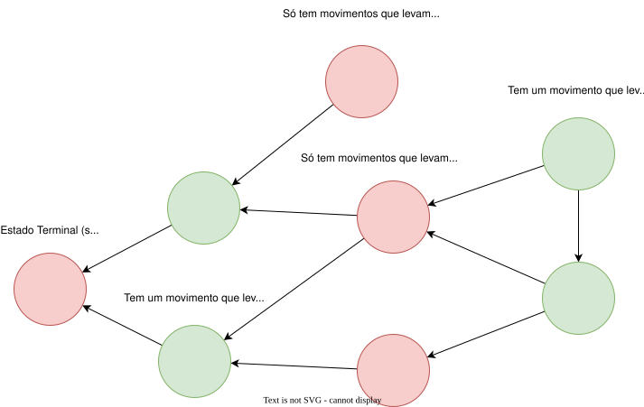
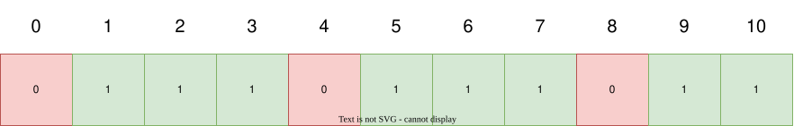


  recommended:
    - name: Stones
      url: https://atcoder.jp/contests/dp/tasks/dp_k
      platform: AtCoder
      difficulty: medium
      topics: [estados vencedores, jogo da pilha, programação dinâmica]
      objective: Classifique posições de uma pilha para um conjunto arbitrário de retiradas.
  additional:
    - name: Tree Tag
      url: https://codeforces.com/contest/1404/problem/B
      platform: Codeforces
      difficulty: medium
      topics: [estratégia, árvores, distâncias]
      objective: Decida o vencedor a partir de invariantes, em vez de simular turnos.


# Fundamentos e análise de estados

Esta seção trata principalmente de jogos **finitos**, de **dois jogadores**, determinísticos, de informação perfeita e soma zero: o ganho de um jogador é a derrota do outro. Jogadores alternam turnos e ambos escolhem a melhor jogada possível.

## 1. Classificando o jogo

Um jogo é **imparcial** quando as jogadas disponíveis dependem apenas da posição, não de quem joga. Nim e jogos de retirar pedras são exemplos. Em um jogo **partidário**, cada jogador pode ter movimentos diferentes; ele exige ferramentas mais gerais.

No jogo de **condição normal**, quem faz a última jogada vence. No jogo **misère**, quem faz a última jogada perde. A diferença parece pequena, mas altera os estados terminais e pode invalidar uma estratégia baseada em XOR.

Também separe jogos de vitória/derrota de jogos de pontuação. Se o objetivo é terminar com mais pontos, veja [Jogos de Pontuação e Minimax](jogos-de-pontuacao.md), não apenas posições vencedoras.

## 2. Posições vencedoras e perdedoras

Represente o jogo por um grafo dirigido: um nó é uma posição e uma aresta é uma jogada legal. Para jogos normais sem ciclos, usamos duas classes:

- **posição perdedora (P)**: o jogador da vez perde com jogo perfeito;
- **posição vencedora (N)**: o jogador da vez possui uma jogada que força vitória.

As regras recursivas são a base de quase toda DP de jogos:

1. uma posição terminal é `P`, pois não há jogada;
2. uma posição é `N` se possui ao menos uma transição para `P`;
3. uma posição é `P` se todas as transições levam a `N`.

Essas regras são também uma demonstração por indução na distância até o fim do jogo. Se existe um sucessor perdedor, escolha-o; se todos os sucessores são vencedores, o adversário sempre recebe uma posição favorável.



!!! warning "Ciclos e empates"
    A recorrência direta pressupõe que toda partida termina. Se movimentos podem repetir estados, o jogo pode ter empate e a classificação binária `P/N` deixa de ser suficiente. Problemas desse tipo exigem análise de grafos, retrograde analysis ou regras extras sobre repetição.

## 3. Jogo da pilha

Em um jogo de retirada, há uma pilha com `s` pedras e, a cada turno, é permitido retirar uma quantidade de um conjunto `moves`. Para condição normal, `win[s]` é verdadeiro se existe uma retirada que deixa uma posição perdedora.

```cpp
vector<char> winning_positions(int max_stones, const vector<int>& moves) {
    vector<char> win(max_stones + 1, false); // win[0] = posição P

    for (int stones = 1; stones <= max_stones; stones++) {
        for (int take : moves) {
            if (take <= stones && !win[stones - take]) {
                win[stones] = true;
                break;
            }
        }
    }
    return win;
}
```

Se `moves={1,3,4}`, os primeiros estados são:

| Pedras `s` | 0 | 1 | 2 | 3 | 4 | 5 | 6 | 7 |
|---|---:|---:|---:|---:|---:|---:|---:|---:|
| Posição | P | N | P | N | N | N | N | P |

Para vencer, escolha uma retirada que alcance uma coluna `P`. A DP também registra a jogada escolhida se o problema pede a estratégia, não apenas o vencedor.

## 4. Caso especial: retirar de 1 até k

Quando todo valor de `1` a `k` pode ser retirado, as posições perdedoras são exatamente os múltiplos de `k+1`.

**Demonstração.** De um múltiplo de `k+1`, qualquer retirada entre `1` e `k` chega a um resto não nulo. De qualquer resto `r` entre `1` e `k`, retire `r` para chegar ao múltiplo anterior. Logo, por indução, múltiplos são `P` e os demais são `N`.

Em outras palavras, posições perdedoras são múltiplos de `k+1` e posições vencedoras são não múltiplos de `k+1`, pois se você estiver em uma posição que é múltiplo de `k+1`, qualquer jogada leva à uma posição que não é múltiplo de `k+1` (vencedora). E se você estiver em uma posição que não é múltiplo de `k+1`, você pode sempre jogar para um múltiplo de `k+1` (perdedora), garantindo a vitória.

Por exemplo , para `k = 3` e `n = 10`, as posições perdedoras e vencedoras são mostradas na figura abaixo. A estratégia vencedora é sempre deixar um múltiplo de `k+1` para o adversário.



Essa estratégia de deixar um múltiplo é um exemplo de **invariante modular**. Para um conjunto de retiradas arbitrário, entretanto, não assuma que existe um padrão simples: use a DP ou Grundy numbers.

## 5. Estratégia como certificado

Saber que uma posição é `N` não basta para jogar. Para cada estado vencedor, guarde uma transição para um estado perdedor. Ao iniciar em `N`, escolha essa transição; depois de toda jogada adversária, a posição volta a ser `N` e o mesmo argumento se repete.

Esse padrão — achar uma posição ruim para o adversário e sempre devolvê-la — reaparece em Nim, Sprague–Grundy e jogos misère.

<!-- AUXÍLIO VISUAL 1

Criar uma linha de posições 0 a 10 para moves={1,3,4}, com setas para movimentos legais e cores para P/N. Destacar a estratégia de sempre apontar para uma posição P.

Arquivo sugerido: images/jogo-da-pilha.svg
-->

O próximo passo é [Nim](nim.md), onde muitas pilhas são resolvidas sem explorar todo o produto cartesiano de estados.

## Problemas

{{ exercise_list(exercises) }}
